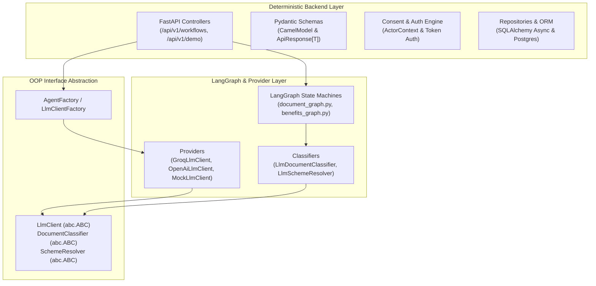

# Agent & AI Architecture Rules

**Status:** Standardized Architecture Specification  
**Context:** Guidelines and OOP rules agreed upon for AI components, LLM abstractions, and agent integration in SeniorLife OS.

---

## 1. Core Architectural Boundary

In SeniorLife OS, there is a strict separation between **deterministic backend infrastructure** and **probabilistic AI / LangGraph workflows**:



---

## 2. Decided Architecture Rules

### Rule 1: No Overcomplicated Dependency Injection for AI Nodes
- **Decision:** Do **not** build complex Spring-style `@Bean` or `@Component` container frameworks in FastAPI for LangGraph nodes.
- **Rationale:** LangGraph graphs function best with stateless, functional node transitions that receive state dictionaries (`TypedDict`). Overengineering DI containers around AI nodes introduces brittle runtime magic.
- **Standard:** Use standard Python OOP interfaces (`abc.ABC`) and factory lookup (`LlmClientFactory.create(config)`).

### Rule 2: Strict OOP Interface Contracts
- All external LLM vendors and AI agents must implement typed abstract base classes located in [`backend/agents/interfaces.py`](file:///C:/Users/rohan/Desktop/SeniorLifeOS/backend/agents/interfaces.py):
  1. **`LlmClient`**: Contract for sending prompts and receiving typed Pydantic models:
     ```python
     class LlmClient(ABC):
         @abstractmethod
         def generate_structured(self, prompt: str, schema: type[T]) -> T:
             """Invoke LLM and return a validated instance of schema T."""
     ```
  2. **`DocumentClassifier`**: Interface for OCR text document categorization:
     ```python
     class DocumentClassifier(ABC):
         @abstractmethod
         def classify(self, page_text: str, known_values: dict[str, str] | None = None) -> DocumentTypeChoice:
             """Classify document type with privacy redaction applied."""
     ```
  3. **`SchemeResolver`**: Interface for government welfare matching:
     ```python
     class SchemeResolver(ABC):
         @abstractmethod
         def resolve(self, need_text: str, candidates: list[dict[str, Any]]) -> SchemeChoice:
             """Match senior need text against curated scheme candidates."""
     ```

### Rule 3: Zero PII Transmitted to LLMs (Privacy-First)
- **Hard Guardrail:** Under no circumstance should raw Personal Identifiable Information (Aadhaar, PAN, phone numbers, exact bank account digits) be sent in an LLM prompt.
- **Redaction Pipeline:**
  - `redact_text(text, known_values)` scans text for 12-digit numbers (Verhoeff checked), 10-character PAN patterns, and dates before passing text to any `LlmClient`.
  - Sensitive identifiers are replaced with deterministic placeholders (`<IDENTIFIER_1>`, `<IDENTIFIER_2>`).
  - Storage uses one-way **HMAC-SHA256 keyed hashes** (`keyed_hash()`) and masked display (`****-****-1234`).

### Rule 4: Deterministic vs. Probabilistic Responsibility
| Operation | Responsibility | Layer |
| :--- | :--- | :--- |
| File Upload & Validation | Deterministic | FastAPI / Pydantic |
| Document Type Heuristics | Deterministic Keywords -> Fallback LLM | `LlmDocumentClassifier` |
| Field Normalization (Date, Income) | Deterministic Python regex & ISO parsing | `backend/tools/demo_tools.py` |
| Eligibility Rule Assessment | Deterministic Comparator Engine (`evaluate_rule`) | `benefits_graph.py` |
| Needs Interpretation / Unclear Need | Probabilistic LLM Matching | `LlmSchemeResolver` |
| Application Package Handoff | Deterministic Hash & Package Builder | LangGraph side-effect node |

### Rule 5: Fallback & Mock Providers
- Any AI component must work out-of-the-box in local development and offline CI without requiring active OpenAI or Groq API keys.
- If API keys are missing or provider is configured to `mock`:
  - `MockLlmClient` returns structured test decisions without network I/O.
  - Document classifier falls back to keyword matching (`income_certificate`, `pension`, `residence`).
  - Scheme resolver matches candidate catalog IDs directly.

---

## 3. Directory Layout

```
backend/agents/
├── __init__.py           # Package exports
├── interfaces.py         # Abstract Base Classes (LlmClient, DocumentClassifier, SchemeResolver)
├── factory.py            # Static factory for provider instantiation (LlmClientFactory)
├── providers/            # Vendor-specific implementations
│   ├── groq_provider.py    # ChatGroq client with json_mode
│   ├── openai_provider.py  # ChatOpenAI client with structured outputs
│   └── mock_provider.py    # Zero-network offline testing provider
└── classifiers/          # High-level agent classifiers
    ├── document_classifier.py
    └── scheme_resolver.py
```
