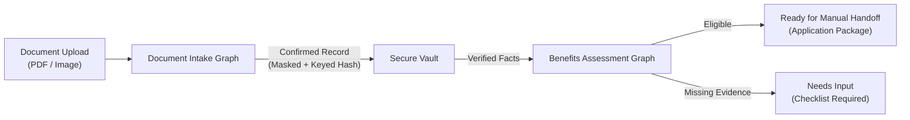
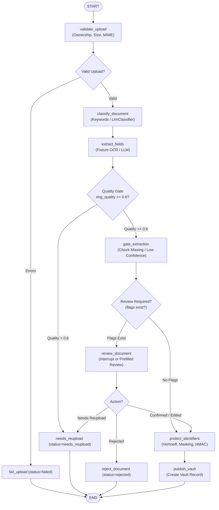
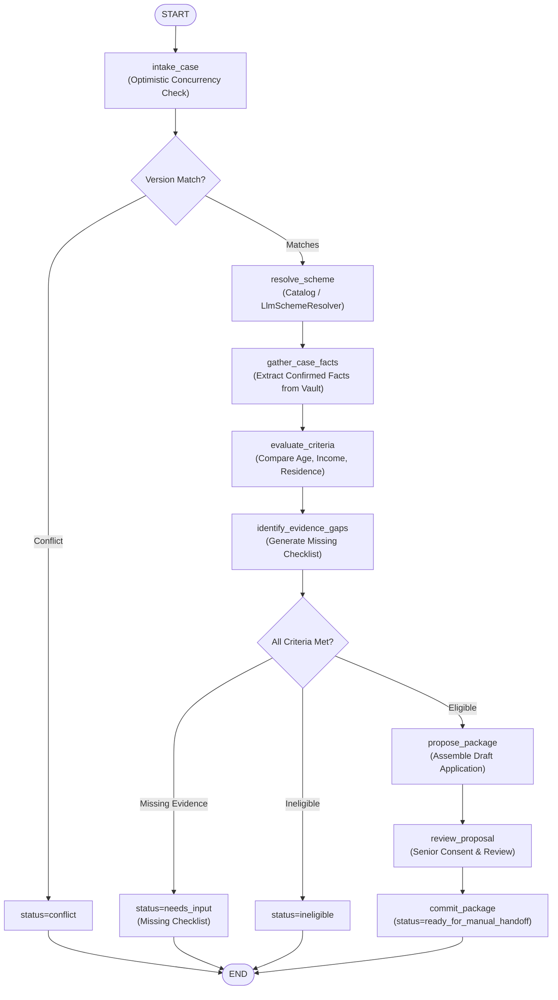

# Teammate Core Workflow Logic & State Machine Specification

**Status:** Technical Reference & Logic Specification  
**Context:** Documents the core LangGraph state machines, decision nodes, confidence gates, human-in-the-loop reviews, and privacy guardrails implemented in SeniorLife OS.

---

## 1. System Overview

The core logic handles the complex journey of senior welfare assistance using **LangGraph state machines**. It coordinates two decoupled workflows:

1. **Document Intake Graph (`backend/graphs/document_graph.py`)**: Ingests document uploads, evaluates OCR quality, normalizes fields, executes human-in-the-loop corrections, and publishes redacted vault records.
2. **Benefits Case Assessment Graph (`backend/graphs/benefits_graph.py`)**: Assesses a senior's eligibility against welfare scheme catalogs using confirmed vault records, computes evidence gaps, and compiles an approved handoff package.

---

## 2. Document Intake Workflow

### 2.1 State Definition (`DocumentState`)
Located in [`backend/graphs/document_graph.py`](file:///C:/Users/rohan/Desktop/SeniorLifeOS/backend/graphs/document_graph.py):
- **Inputs**: `actor_id`, `document_id`, `document` (metadata, MIME type, size, OCR pages), `claimed_type`, `review_decision`, `use_interrupt`, `use_llm`.
- **Outputs**: `document_type`, `extracted_fields`, `normalized_fields`, `review_flags`, `identifier_hashes`, `vault_record`, `status`, `errors`, `warnings`.

### 2.2 Execution Nodes & Flow

### 2.3 Detailed Node Behaviors

1. **`validate_upload`**:
   - Asserts `document.owner_id == state.actor_id`.
   - Restricts MIME types: `application/pdf`, `image/png`, `image/jpeg`.
   - File size upper bound: `<= 5 MB`.
   - Checks presence of readable OCR page fixtures.
2. **`classify_document`**:
   - Resolves document category: `identity`, `income_certificate`, `residence_proof`, or `unknown`.
   - Employs deterministic keyword detection with fallback to `LlmDocumentClassifier`.
3. **`extract_fields`**:
   - Extracts structured field candidates with confidence scores (0.0 to 1.0).
   - Enforces required fields per document type:
     - `identity`: `name`, `date_of_birth`
     - `income_certificate`: `name`, `annual_income`, `issue_date`
     - `residence_proof`: `name`, `residence_state`, `issue_date`
4. **`gate_extraction` (Confidence Gate)**:
   - Evaluates overall OCR quality. If image quality `< 0.60`, terminates early with status `needs_reupload`.
   - Checks confidence against threshold (`CONFIDENCE_THRESHOLD = 0.90`).
   - If fields fall below threshold or dates are malformed, attaches review flags (`review_required`, `low_confidence_fields`, `missing_required_fields`).
5. **`review_document` (Human-in-the-Loop)**:
   - When running with state persistence (`use_interrupt=True`), pauses graph execution using LangGraph `interrupt()` for senior / staff review.
   - Supports prefilled `review_decision` payloads during automated API execution.
   - Applies manual edits, overrides, and normalizes date formats (e.g. `"15/01/2025"` -> ISO `"2025-01-15"`).
6. **`protect_identifiers` & `publish_vault`**:
   - Validates Indian Aadhaar numbers via the **Verhoeff checksum algorithm**.
   - Masks sensitive numbers (`****-****-9012`).
   - Computes deterministic **HMAC-SHA256 keyed hashes** for secure storage and duplicate detection.
   - Emits finalized `vault_record` with `status="confirmed"`.

---

## 3. Benefits Case Assessment Workflow

### 3.1 State Definition (`BenefitsState`)
Located in [`backend/graphs/benefits_graph.py`](file:///C:/Users/rohan/Desktop/SeniorLifeOS/backend/graphs/benefits_graph.py):
- **Inputs**: `actor_id`, `case_id`, `case_version`, `expected_case_version`, `scheme_id`, `need_text`, `jurisdiction`, `profile_facts`, `documents` (vault records).
- **Outputs**: `scheme`, `facts`, `criterion_results`, `missing_inputs`, `assessment`, `application_package`, `status`, `route`.

### 3.2 Execution Nodes & Flow

### 3.3 Detailed Node Behaviors

1. **`intake_case` (Optimistic Concurrency)**:
   - Verifies `expected_case_version == case_version` to prevent concurrent race conditions on cases.
2. **`resolve_scheme`**:
   - Matches senior need text against curated schemes (e.g. `demo_senior_support` Pension).
   - Employs `LlmSchemeResolver` for fuzzy/unclear senior statements.
3. **`gather_case_facts`**:
   - Extracts confirmed facts from attached vault documents (e.g., confirmed `annual_income`, `residence_state`, `date_of_birth`).
   - Compares dates and flags contradictions if profile facts disagree with vault records.
4. **`evaluate_criteria`**:
   - Assesses rules deterministically (e.g. `age >= 60`, `annual_income <= 200000`, `residence_state == "DL"`).
   - Results in: `eligible`, `ineligible`, or `unknown`.
5. **`identify_evidence_gaps`**:
   - If a criterion cannot be proven due to missing documents, marks status as `needs_input` and generates an actionable checklist of required documents.
6. **`commit_package`**:
   - Assembles immutable submission package with evidence hashes.
   - Sets status to `ready_for_manual_handoff` for human signature.

---

## 4. Privacy & Guardrail Architecture

Located in [`backend/utils/privacy.py`](file:///C:/Users/rohan/Desktop/SeniorLifeOS/backend/utils/privacy.py):

| Mechanism | Purpose | Implementation Detail |
| :--- | :--- | :--- |
| **Verhoeff Checksum** | Validate Aadhaar structure | Rejects numbers with corrupted checksums or invalid starting digits (0/1) |
| **Masking** | UI display without PII | Retains only last 4 digits (`****-****-1234`) |
| **Keyed Hash** | Deduplication & Storage Index | HMAC-SHA256 seeded with secret `SENIORLIFE_HASH_KEY` |
| **Prompt Redactor** | LLM Guardrail | Automatically redacts sensitive identifiers from text prior to LLM calls |

---

## 5. Pre-Seeded Demo Scenarios

The teammate designed 4 deterministic scenarios in [`backend/demo/demo_cases.py`](file:///C:/Users/rohan/Desktop/SeniorLifeOS/backend/demo/demo_cases.py):

1. **`doc-income-success`**:
   - Income certificate with malformed date (`"15/01/2025"`).
   - Normalizes to `"2025-01-15"`, applies human confirmation, and produces a confirmed vault record.
2. **`doc-blurry-reupload`**:
   - Low image quality (0.25) simulation.
   - Fails confidence threshold gate, preventing corrupt vault publication and terminating in `needs_reupload`.
3. **`benefits-pension-success`**:
   - Full end-to-end integration: feeds confirmed income vault record into benefits assessment.
   - Verifies age, residence, and income. Assembles completed `ready_for_manual_handoff` application package.
4. **`benefits-missing-evidence`**:
   - Evaluates pension without an income certificate.
   - Marks income criterion as `unknown` and gracefully halts in `needs_input` with an evidence requirement checklist.
